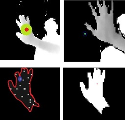

# Hand tracking

<p align="center">
  
</p>


Depth-based hand tracking adapted for a close-range PMD nano camera.

Students: Sa'ar Zehavi.

Supervision: Aaron Wetzler.

## Status

Original MATLAB scripts and C++ MEX source have been recovered, together with the [June 2013 report](docs/report.pdf). The nine source files in `source/` are byte-for-byte copies of the original project submission. This is an archival snapshot, not a tested modern release.

## Original code

The nine recovered files are in [`source/`](source/): the MATLAB scripts `test1.m`, `test2.m` and `pmdrecorder.m`, and the C++ MEX gateway `iterate.cpp` with `Hand`, `Image` and `Queue` sources. They are byte-for-byte copies of the original submission. PMD SDK components are not included.

## Running

The original live-camera setup used 64-bit Windows MATLAB and a PMD CamBoard nano time-of-flight camera. Obtain compatible PMD camera drivers, the PMD MATLAB interface, and the `camboardnano.W64.pap` and `camboardnanoproc.W64.ppp` plugins from their rights holder. These SDK components are not redistributed here.

1. Clone this repository and open MATLAB in `source/`.
2. Configure a MATLAB-supported C++ compiler with `mex -setup C++`.
3. Build the gateway from its three translation units:

```matlab
mex -output Iterate iterate.cpp Hand.cpp Image.cpp
```

4. Put your compatible PMD MATLAB interface on the MATLAB path and make its camera plugins discoverable.
5. With the camera attached, run `test1` for the live tracker. Stop its original continuous loop with Ctrl+C.

`pmdrecorder` records depth frames into the cell array `W` and saves `EasyMotions.mat`. `test2` expects a populated `W` in the workspace and uses a fixed frame range. Camera dimensions and geometric parameters are hardcoded in the historical scripts; adapt these for a different sensor. Recorded participant data and the original precompiled binaries are deliberately not included.

**Verification:** source recovery and file hashes were checked. MATLAB and the PMD camera/SDK are unavailable on the recovery machine, so compilation and tracking have not been tested.

## Links

- [Project entry on Aaron Wetzler's website](https://twerdster.github.io/#hand-tracking)
- [Project demonstration](https://www.youtube.com/watch?v=EvEUtYNojeQ)
- [Original report](docs/report.pdf)

- [Code](https://github.com/twerdster/hand-tracking-pmd/tree/main/source)

## Attribution and Updates

Original project by Sa'ar Zehavi, supervised by Aaron Wetzler at the Technion. The original website identifies the code as open source but the recovered package contains no explicit code license; no new license has been assigned. PMD SDK binaries, camera plugins, MATLAB MEX binaries and recordings are excluded. Original authors can open an issue to contribute updates or request corrections or removal of their material.

Figure provenance: `assets/project-preview.jpg` is the original student-project figure from the archived project page on Aaron Wetzler's website, copied without modification. It is a historical figure, not a new tracking result.

