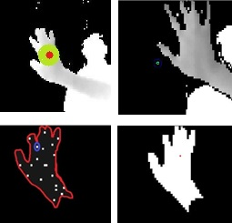

# Historical implementation and recovery notes

This record describes the recovered historical project, its setup requirements and the checks made during recovery. See the [current README](../README.md) for the project overview.

# Hand tracking

<p align="center">
  
</p>


MATLAB drivers and a C++ MEX implementation for tracking hands in PMD CamBoard nano depth images.

Student: Sa'ar Zehavi.

Supervision: Aaron Wetzler.

## Available source

The tracker takes close-range depth frames from a PMD CamBoard nano, segments candidate hand regions and estimates hand positions across frames. The recovered MATLAB drivers call a C++ MEX gateway that returns tracking-support flags, image coordinates with detection flags, and estimated 3D coordinates for up to two hands. These outputs are defined in source; tracking accuracy was not evaluated during recovery.

[`source/`](../source/) contains nine files copied byte-for-byte from the original submission: `test1.m`, `test2.m`, `pmdrecorder.m`, `iterate.cpp`, and the `Hand`, `Image` and `Queue` sources/headers. The [June 2013 report](../docs/report.pdf) explains the algorithm. PMD SDK components, precompiled MEX binaries and recordings are not included.

## Setup and use

The plugin filenames indicate a 64-bit Windows MATLAB setup, with a compatible C++ MEX compiler and a PMD CamBoard nano. Obtain the PMD drivers, MATLAB interface and `camboardnano.W64.pap` / `camboardnanoproc.W64.ppp` plugins from their rights holder; they are not redistributed here.

The following build sequence is derived from the source and has not been compiled or run on the recovery machine. It requires a compatible MATLAB/compiler installation:

1. Open MATLAB in `source/` and configure the C++ compiler with `mex -setup C++`.
2. Compile the three translation units into the case-sensitive gateway name used by the scripts:

   ```matlab
   mex -output Iterate iterate.cpp Hand.cpp Image.cpp
   ```

3. Add the PMD MATLAB interface to the MATLAB path and configure the plugin loader according to that SDK's documentation. The scripts pass bare plugin filenames to `pmdOpen`; their original plugin-search configuration was not recovered.
4. With the camera attached, run `test1` for the continuous live loop; stop it with Ctrl+C.

The gateway uses the historical MEX array API; modern MATLAB/compiler compatibility is unverified.

`pmdrecorder` collects depth frames into the cell array `W` and saves `EasyMotions.mat`. `test2` expects `W` already in the workspace and accesses frames 120 through 202, so it needs at least 202 entries. In `test1`, the PMD depth array is transposed before calling the gateway with dimensions 120 and 165. Those dimensions and the geometry/threshold values are hardcoded and need review for any different sensor. `test1` and `test2` are demonstration drivers rather than automated assertion tests.

## Validation and limitations

The original recovery record states that the nine source files and their hashes were checked. This revision compared SHA-256 hashes of all nine source files with the starting Git commit and inspected the MATLAB drivers and MEX inputs/outputs; the source files are unchanged. MATLAB, the PMD SDK/plugins, recordings and camera were unavailable for recovery validation, so no compilation or live/offline tracking test is recorded.

The report's conclusions describe tracking drift, estimates moving toward the wrist or elbow, and jumping estimates. The demonstration link is historical and has not been reviewed during this revision; no current performance or robustness evaluation is available.

## Links

- [Project entry on Aaron Wetzler's website](https://twerdster.github.io/#hand-tracking)
- [Historical demonstration (not reviewed)](https://www.youtube.com/watch?v=EvEUtYNojeQ)
- [Original report](../docs/report.pdf)
- [Unfinished 2013 draft slides](../docs/real-time-hand-tracking-draft-2013.pptx)

## Attribution and reuse

Original project by Sa'ar Zehavi, supervised by Aaron Wetzler at the Technion. The original website identifies the code as open source but the recovered package contains no explicit code license; no new license has been assigned. PMD SDK binaries, camera plugins, MATLAB MEX binaries and recordings are excluded. Original authors can open an issue to contribute updates or request corrections or removal of their material.

Sa'ar Zehavi approved website inclusion on 2026-11-12 and supplied the draft slides on 2026-11-13. They contain unfinished illustrations and a first-order approximation step that, when sharing the draft in 2013, he said he no longer used. The June report and recovered source are separate archival records; the slides are historical design material. See [provenance and permission scope](../PROVENANCE.md). No code license or broader code-use permission is added.

Figure provenance: `assets/project-preview.jpg` is the original student-project figure from the archived project page on Aaron Wetzler's website, copied without modification. It is a historical figure, not a new tracking result.
